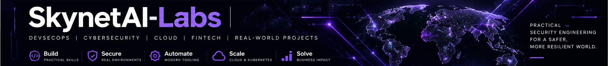

# Adam Baig | SkynetAI-Labs

**Full-Cycle Recruitment | GTM & Commercial Hiring | International Business Development | AI-Fluent**

I combine a background in full-cycle recruitment, executive search, business development and international client management with hands-on technical learning. At **SkynetAI-Labs**, I build practical cybersecurity, cloud and fintech projects to deepen my understanding of the systems, products and technical roles involved.

This portfolio combines hands-on implementation with security assessment, evidence-led reporting and commercial research. The projects are educational; they do not represent production banking systems or verified customer outcomes.

## Recruitment and Commercial Experience

**Full-cycle recruiter | GTM & commercial hiring | EMEA & international | AI-fluent**

I bring 20+ years of client-facing recruitment and business development, owning searches from intake to close across shifting priorities. I have recruited sales managers, sales engineers, business development, contracts, procurement, operations and IT professionals, alongside directors and C-suite through executive search.

My sector experience spans oil and gas, power, nuclear, renewables, mining, construction and IT for energy clients. International hiring and mobilisation have covered the UK, Norway, Romania, Libya, Kuwait, India, Malaysia and Australia.

### Selected Recruitment and Business Results

- **Delivery:** filled approximately 75% of the roles I took on, with a typical time-to-fill of 1–2 weeks.
- **Mobilisation at scale:** mobilised approximately 170 personnel for Aggreko and APR Energy power projects in Libya on tight timelines.
- **Business growth:** built Ascent Energy Global from a one-person start-up to 11 employees, generating approximately US$100,000 a month in contractor revenue; helped grow Voyage Energy Group from 3 to 17 people.
- **Investment:** helped secure private equity backing for Voyage Energy Group from Hamilton Bradshaw, including presenting the business face to face to James Caan.
- **Commercial hiring:** recruited sales managers and sales engineers for Siemens, Dresser Rand and other clients. Two decades of quota-driven outbound selling—around 400 calls and 4+ booked meetings a week—inform how I assess sales and customer-facing talent.
- **Major projects:** supported recruitment for the approximately US$26 billion Inpex Ichthys LNG project and contributed to the EnQuest Kraken, BG Global Framework and Total Clove wins.

### Career Experience

- **Ascent Energy Global — Director, Recruitment & Business Development (2013–2021):** ran full-cycle commercial, technical and IT searches; partnered with hiring managers at Siemens, GE Power, APR Energy, Dresser Rand, Elliott Turbo, Sulzer, Aggreko and Alstom Power. Built diverse international pipelines through market mapping, passive-candidate headhunting and referrals; coordinated interviews, negotiated rates, contracts, rotations and travel, and supported acceptance, visas and deployment. Managed client relationships and search pipelines in Salesforce and the company CRM.
- **Voyage Energy Group — Vice President & Co-Founder, Recruitment & Business Development (2012–2013):** co-founded the business, helped secure investment and grow the team, and won Siemens, MAN Turbo, MAN Ferrostaal, Ansaldo, Dresser Rand and Metka through outbound business development. Qualified requirements with senior stakeholders and recruited and deployed specialist engineers internationally.
- **Competentia AS — Principal Consultant, Recruitment (2011–2012):** executive search and specialist international oil, gas and IT recruitment; mapped competitor organisations and approached passive senior candidates. Supported ENI Goliat, BP Clair Ridge and BP Skarv, with stakeholder qualification and rate/fee negotiation.
- **Opus Sterling Recruitment Limited — Principal Consultant, Recruitment, Contract (2010–2011):** introduced structure to the energy division and opened and managed accounts with Apache Australia, OMV Petrom, Shell Malaysia, Cairn Energy India and Kuwait Oil Company.
- **Quest Executive — Principal Consultant, Recruitment (2002–2010):** full-cycle commercial and technical recruitment across construction, energy and IT; built pipelines through cold calling, networking, referrals and client meetings. Developed Jacobs Engineering, Amec, Aker and Areva into repeat-business accounts.

### Recruiting Practice, Tools and AI

My work covers intake and role scoping, sourcing strategy, diverse pipeline building, market mapping, screening, structured interviewing, compensation and offer negotiation, and closing. I partner with hiring managers on candidate quality, salaries/rates and timing, while keeping candidates informed through onboarding and international deployment.

Tools include **Bullhorn ATS, Salesforce, LinkedIn Sales Navigator and Microsoft Office**. My Salesforce Trailhead learning includes **Mountaineer rank and 52 badges**. I use AI for candidate research, market mapping and outreach.

At **SkynetAI-Labs (October 2024–present)**, I build independent technology projects and am designing **PeachBox.**, an AI-assisted recruitment platform for sourcing and candidate matching, currently at the early design stage.

My learning includes the **Google AI Professional Certificate (October 2026)**, **Google Cybersecurity Professional Certificate (September 2026)** and **Google Cloud Digital Leader Training (October 2026)**. **CompTIA Security+ is in progress.** The cloud entry describes training rather than a certification exam result.

## Start Here

| Project | What it demonstrates | Evidence |
|---|---|---|
| [Revolut Business fintech case study — Labs 08–12](https://github.com/SkynetAI-Labs/Revolut-fintech-api-security-case-study) | A fictional banking API, JWT/RBAC and customer isolation, Docker/CI, explainable transaction monitoring and UK SME GTM research | [231-test main-branch verification](https://github.com/SkynetAI-Labs/Revolut-fintech-api-security-case-study/actions/runs/40136670923) · [Phase-by-phase audit](https://github.com/SkynetAI-Labs/Revolut-fintech-api-security-case-study/blob/main/AUDIT_LABS_08_12.md) |
| [Secure CI/CD pipeline — Lab 03](https://github.com/SkynetAI-Labs/lab-03-secure-cicd-pipeline) | Tests and security gates, publishing the scanned image, digest/action pins, SBOM and signed provenance | [Verified main workflow](https://github.com/SkynetAI-Labs/lab-03-secure-cicd-pipeline/actions/runs/40134729959) · [Audit](https://github.com/SkynetAI-Labs/lab-03-secure-cicd-pipeline/blob/main/SECURITY_AUDIT.md) |
| [Security monitoring and incident response — Lab 07](https://github.com/SkynetAI-Labs/lab-07-security-monitoring-response) | Historical regional AWS detection, request correlation and SNS-to-SQS alert delivery, followed by teardown | [Incident report](https://github.com/SkynetAI-Labs/lab-07-security-monitoring-response/blob/main/docs/incident-report.md) · [Open findings](https://github.com/SkynetAI-Labs/lab-07-security-monitoring-response/blob/main/SECURITY_AUDIT.md) |

## Verification Snapshot — 24 October 2026

- **Fintech case study:** 231 tests passed, with 10 dependency deprecation warnings. Bandit, pip-audit, Gitleaks, Docker build and the configured Trivy HIGH/CRITICAL gate passed. Two payment-input/balance-integrity defects were fixed with 31 added regression cases.
- **Labs 02 and 03:** the reviewed automated workflows passed.
- **Lab 04:** retained historical Checkov evidence records 41 passed and 4 failed. The repository audit also identified missing explicit HTTPS-only bucket enforcement; no fresh deployment or scan is claimed.
- **Lab 05:** Terraform formatting, initialization and validation passed; Checkov reported **113 passed, 12 failed**. Newly added delivery paths still require live verification.
- **Lab 06:** YAML parsing passed; Checkov reported **279 passed, 4 failed**. Network-policy and authenticated-RBAC evidence limitations are documented.
- **Lab 07:** Terraform validation passed; Checkov reported **54 passed, 10 failed**. Regional coverage and short retention are documented lab limitations.

Security findings remain visible. Passing checks describe the configured tests at their run date; they do not establish production readiness. Each repository links its dated audit and recommendations.

## Portfolio Labs and Projects

| Lab | Focus |
|---|---|
| [01 — Linux security](https://github.com/SkynetAI-Labs/lab-01-linux-security-hardening) | Historical Lynis assessment, package updates, password policy and firewall evidence |
| [02 — Automated security scanning](https://github.com/SkynetAI-Labs/lab-02-automated-security-scanning) | pytest, Semgrep, Gitleaks, pip-audit and Trivy |
| [03 — Secure CI/CD](https://github.com/SkynetAI-Labs/lab-03-secure-cicd-pipeline) | Security gates, container delivery and supply-chain evidence |
| [04 — Terraform and S3 security](https://github.com/SkynetAI-Labs/lab-04-aws-terraform-cloud-security) | Storage controls, logging, event configuration and risk assessment |
| [05 — IAM and CloudTrail](https://github.com/SkynetAI-Labs/lab-05-aws-iam-cloudtrail-security) | Restricted IAM, audit logging and Terraform validation |
| [06 — Kubernetes security](https://github.com/SkynetAI-Labs/lab-06-kubernetes-security) | Pod hardening, RBAC, selected-pod network policies and secret-file checks |
| [07 — Monitoring and response](https://github.com/SkynetAI-Labs/lab-07-security-monitoring-response) | AWS detection, alert delivery and incident investigation |
| [08 — Revolut Business API](https://github.com/SkynetAI-Labs/Revolut-fintech-api-security-case-study#lab-1--business-banking-api) | FastAPI, SQLite, internal transfers and financial integrity |
| [09 — Revolut authentication and API security](https://github.com/SkynetAI-Labs/Revolut-fintech-api-security-case-study#lab-2--authentication-and-api-security) | JWT, Argon2id, RBAC, customer isolation and rate limits |
| [10 — Revolut Docker and DevSecOps](https://github.com/SkynetAI-Labs/Revolut-fintech-api-security-case-study#lab-3--docker-github-actions-and-devsecops) | Container hardening, dependency checks and automated scanning |
| [11 — Revolut transaction monitoring](https://github.com/SkynetAI-Labs/Revolut-fintech-api-security-case-study#lab-4--fraud-detection-and-transaction-monitoring) | Four explainable rules, isolated alerts, administrator review and atomic integration |
| [12 — Revolut market intelligence and GTM](https://github.com/SkynetAI-Labs/Revolut-fintech-api-security-case-study/tree/main/docs/gtm) | UK SME research, competitor comparison, provisional targeting and hypothetical acquisition economics |
| [GitLab 01 — Secure CI/CD Pipeline Engineering](https://github.com/SkynetAI-Labs/gitlab-secure-cicd-pipeline) | Release-risk API, GitLab security gates, hardened containers and commercial case study · [GitLab repository](https://gitlab.com/SkynetAI-Labs/gitlab-secure-cicd-pipeline) |
| [GitLab 02 — Competitive Evaluation & Sales Discovery](https://github.com/SkynetAI-Labs/gitlab-secure-cicd-pipeline/tree/main/docs/commercial/lab-02) | Balanced GitLab/GitHub comparison, buyer discovery, objection handling, cost workbook and pilot scorecard · [GitLab lab](https://gitlab.com/SkynetAI-Labs/gitlab-secure-cicd-pipeline/-/tree/main/docs/commercial/lab-02) |
| [GitLab 03 — Enterprise Buyers & Buying Process](https://github.com/SkynetAI-Labs/gitlab-secure-cicd-pipeline/tree/main/docs/commercial/lab-03) | Buyer-persona hypotheses, stakeholder maps, procurement journey, qualification gaps and interview walkthrough · [GitLab lab](https://gitlab.com/SkynetAI-Labs/gitlab-secure-cicd-pipeline/-/tree/main/docs/commercial/lab-03) |
| [GitLab 04 — Commercial Strategy & Sales Execution](https://github.com/SkynetAI-Labs/gitlab-secure-cicd-pipeline/tree/main/docs/commercial/lab-04) | Account prioritisation, positioning, unsent outreach examples, hypothetical funnel modelling and 30/60/90-day execution plan · [GitLab lab](https://gitlab.com/SkynetAI-Labs/gitlab-secure-cicd-pipeline/-/tree/main/docs/commercial/lab-04) |

**Labs 08–12 are successive phases of one repository and share one combined application test suite.** The 231-test total is not a separate result for each phase.

## Commercial Research and Technical Skills

The GTM case study includes a 25-source register, competitor analysis, assumption-based segment scoring and a hypothetical 90-day pilot. Its base model assumes 75 hours and GBP150 cash, or GBP2,400 economic cost at an assumed GBP30 hourly value. Two expected activations are a model output, not customers acquired. Complete cross-border quotes and customer validation remain open.

Technical work covers Python/FastAPI/SQLite, JWT and Argon2id, Docker, GitHub Actions, security scanning, AWS/Terraform, Kubernetes RBAC/network policies and evidence-based incident investigation. Detailed implementations, historical milestones and limitations are kept in the project repositories.

**Engineering:** Design → Build → Test → Validate → Document → Improve  
**Security:** Identify → Analyse → Remediate → Rescan → Verify → Document  
**Commercial research:** Define → Research → Compare → Model → Challenge Assumptions → Document

## Independence and Contact

The Revolut work is an independent educational simulation and case study, not affiliated with or endorsed by Revolut. All banking customers, accounts and transactions are fictional. No interviews, outreach campaigns, provider partnerships or acquired customers are claimed.

[LinkedIn](https://www.linkedin.com/in/adambaiguk) · [GitHub projects](https://github.com/SkynetAI-Labs?tab=repositories)

**Commercial experience. Practical technical learning. Documented results.**

